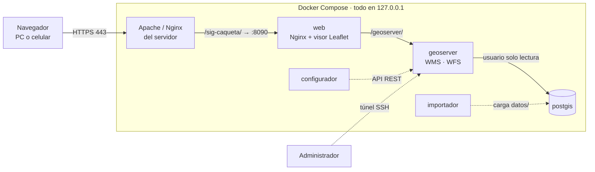

# SIG Web · Departamento del Caquetá

Visor web para consultar municipios, hospitales, instituciones educativas, vías y zonas de riesgo del Caquetá.
Los datos se almacenan en **PostGIS**, **GeoServer** los publica como servicios **WMS/WFS** y un visor **Leaflet** los muestra en el navegador.

Caso práctico del Tema 10 · *Despliegue de Aplicaciones SIG Web en Servidores*.



## Estructura

```
sig-web-caqueta/
├── compose.yaml        Todo el sistema en contenedores (producción y desarrollo)
├── .env.example        Plantilla de variables (copiar a .env)
├── datos/              Capas GeoJSON (EPSG:4326) que se cargan a PostGIS
├── db/                 SQL: roles, vista espacial, validación y consultas de demostración
├── geoserver/estilos/  Simbología SLD
├── frontend/           Visor Leaflet (Vite + npm)
│   └── src/            main.js · config.js · servicios.js · capas.js · consultas.js · ui.js
├── infra/
│   ├── docker/         Dockerfiles (web multi-stage, herramientas GDAL) y arranque
│   ├── apache/         Publicación detrás de Apache (por ruta o subdominio)
│   ├── nginx/          Configuración del contenedor web y de la instalación nativa
│   └── scripts/        Pasos 01-07; los usan los contenedores y la instalación nativa
├── docs/               Desarrollo y despliegue
└── .github/workflows/  CI/CD: validar, construir y desplegar
```

## Inicio rápido

```bash
git clone https://github.com/TU_USUARIO/sig-web-caqueta.git
cd sig-web-caqueta
cp .env.example .env            # cambia las contraseñas
docker compose up -d --build    # PostGIS + datos + GeoServer + visor
```

- Visor: http://localhost:8090
- GeoServer: http://localhost:8086/geoserver/web
- Programar el visor con recarga en vivo: `cd frontend && npm install && npm run dev`

Guías: [desarrollo local](docs/DESARROLLO.md) · [despliegue en servidor](docs/DESPLIEGUE.md) (Docker detrás de Apache, o instalación nativa paso a paso).

## Datos

| Capa | Geometría | Fuente |
|---|---|---|
| `municipios` | MultiPolygon | DANE, Marco Geoestadístico Nacional 2018 (16 municipios) |
| `hospitales` | Point | **Ilustrativa**, creada para la demostración |
| `instituciones_educativas` | Point | **Ilustrativa** |
| `vias` | LineString | **Ilustrativa** (trazado esquemático entre cabeceras) |
| `zonas_riesgo` | MultiPolygon | **Ilustrativa** |

Para usar datos oficiales basta con reemplazar los GeoJSON de `datos/` (mismos nombres de campo) y ejecutar `docker compose up importador`.

## Seguridad

- `.env` no se versiona; las contraseñas nunca van en el código ni en el frontend.
- Los contenedores publican sus puertos solo en `127.0.0.1` (Docker se salta `ufw`); el acceso público pasa por Apache/Nginx con HTTPS.
- GeoServer se conecta con `geoserver_app`, un usuario de **solo lectura**.
- El panel `/geoserver/web` y la API `/geoserver/rest` están bloqueados en Nginx; se administran por túnel SSH.

## Tecnologías

Docker Compose · PostgreSQL 16 + PostGIS 3 · GeoServer 3.0 · Nginx · Leaflet 1.9 · Vite 6 · GDAL · GitHub Actions
