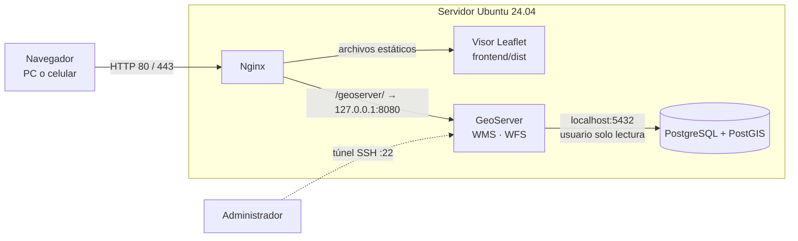

# SIG Web · Departamento del Caquetá

Visor web para consultar municipios, hospitales, instituciones educativas, vías y zonas de riesgo del Caquetá.
Los datos se almacenan en **PostGIS**, **GeoServer** los publica como servicios **WMS/WFS** y un visor **Leaflet** los muestra en el navegador.

Caso práctico del Tema 10 · *Despliegue de Aplicaciones SIG Web en Servidores*.



## Estructura

```
sig-web-caqueta/
├── datos/              Capas GeoJSON (EPSG:4326) que se cargan a PostGIS
├── db/                 SQL: creación de BD y roles, vista espacial, validación, consultas
├── geoserver/estilos/  Simbología SLD
├── frontend/           Visor Leaflet (Vite + npm)
│   └── src/            main.js · config.js · servicios.js · capas.js · consultas.js · ui.js
├── infra/
│   ├── scripts/        Despliegue en el servidor, pasos 01 a 07
│   └── nginx/          Sitio Nginx (producción y Docker)
├── docs/               Arquitectura, desarrollo y despliegue
├── docker-compose.yml  Entorno de desarrollo local
├── .env.example        Plantilla de variables (copiar a .env)
└── .github/workflows/  CI/CD: validar, compilar y desplegar
```

## Inicio rápido

**Desarrollo local** (requiere Docker y Node.js 18 o superior). Detalle en [docs/DESARROLLO.md](docs/DESARROLLO.md).

```bash
cp .env.example .env                 # y cambia las contraseñas
docker compose up -d
docker compose --profile tools run --rm importador
docker compose exec -T postgis sh -c 'psql -U $POSTGRES_USER -d $POSTGRES_DB -v app=$DB_APP_USER -f /db/02_vistas.sql'
GS_URL=http://localhost:8080/geoserver DB_HOST=postgis bash infra/scripts/05_configurar_geoserver.sh
cd frontend && npm install && npm run dev   # http://localhost:5173
```

**Despliegue en un servidor Ubuntu 24.04** (Hostinger, Oracle Cloud u otro VPS). Detalle en [docs/DESPLIEGUE.md](docs/DESPLIEGUE.md).

```bash
git clone https://github.com/TU_USUARIO/sig-web-caqueta.git /srv/sig-web-caqueta
cd /srv/sig-web-caqueta && cp .env.example .env && nano .env
sudo bash infra/scripts/01_preparar_servidor.sh
sudo bash infra/scripts/02_instalar_postgis.sh
bash      infra/scripts/03_importar_datos.sh
sudo bash infra/scripts/04_instalar_geoserver.sh
bash      infra/scripts/05_configurar_geoserver.sh
sudo bash infra/scripts/06_publicar_web.sh
bash      infra/scripts/07_verificar.sh
```

## Datos

| Capa | Geometría | Fuente |
|---|---|---|
| `municipios` | MultiPolygon | DANE, Marco Geoestadístico Nacional 2018 (16 municipios) |
| `hospitales` | Point | **Ilustrativa**, creada para la demostración |
| `instituciones_educativas` | Point | **Ilustrativa** |
| `vias` | LineString | **Ilustrativa** (trazado esquemático entre cabeceras) |
| `zonas_riesgo` | MultiPolygon | **Ilustrativa** |

Para usar datos oficiales basta con reemplazar los GeoJSON de `datos/` (mismos nombres de campo) y volver a correr `03_importar_datos.sh`.

## Seguridad

- `.env` no se versiona; las contraseñas nunca van en el código ni en el frontend.
- Firewall: solo 22, 80 y 443. PostgreSQL y GeoServer escuchan únicamente en `127.0.0.1`.
- GeoServer se conecta con `geoserver_app`, un usuario de **solo lectura**.
- El panel `/geoserver/web` y la API `/geoserver/rest` están bloqueados en Nginx; se administran por túnel SSH.

## Tecnologías

Ubuntu 24.04 · PostgreSQL 16 + PostGIS 3 · GeoServer 3.0 (Java 17) · Nginx · Leaflet 1.9 · Vite 6 · Docker · GitHub Actions
